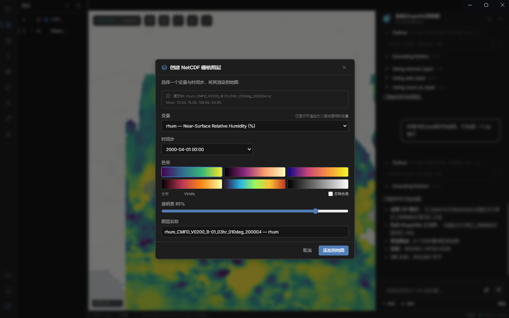

<p align="center">
  
</p>

<h1 align="center">AutoGIS</h1>

<p align="center">
  <a href="README.zh.md">中文</a> |
  <strong>English</strong>
</p>

<p align="center">
  <strong>An agent-driven open-source GIS desktop app — with NetCDF/meteorological data visualization added — geospatial analysis, cartography, automation & knowledge retention through natural language</strong>
</p>

<p align="center">
  <a href="#whats-new-in-this-fork">What's New</a> •
  <a href="#1-introduction">Introduction</a> •
  <a href="#2-feature-overview">Features</a> •
  <a href="#3-getting-started">Getting Started</a> •
  <a href="#4-development">Development</a> •
  <a href="#5-credits--license">Credits & License</a>
</p>

<p align="center">
  
  
  
  
  
  
  
</p>

---

> [!IMPORTANT]
> **This is a secondary-development fork of [OpenGIS](https://github.com/ATFfang/OpenGIS).** It keeps all upstream capabilities and adds the improvements listed below, focused on meteorological / climate data workflows.

## What's New in This Fork

This fork is built on top of OpenGIS and adds the following. For the complete change log, see [`update.txt`](update.txt) / [`update-zh.txt`](update-zh.txt).

### 🆕 NetCDF (`.nc`) import & visualization — built for meteorological research

The headline addition. OpenGIS had no NetCDF support; this fork adds an end-to-end pipeline for CF-style NetCDF files (NCEP/NCAR reanalysis, CMIP, etc.):

- **Import anywhere**: `.nc` / `.nc4` via the Add Data picker, drag-and-drop onto the layer panel, or double-click in the workspace explorer.
- **ArcGIS-style configuration dialog**: importing opens a "Create NetCDF Raster Layer" panel (styled to match AutoGIS) where you pick the variable, time step, level, colour ramp, opacity and layer name.
- **Real raster rendering, not a static image**: the selected 2-D slice is exported to an EPSG:4326 GeoTIFF and served through AutoGIS's existing XYZ tile pipeline — zoomable, style-editable, any CRS.
- **Automatic axis detection**: lat / lon / time / level recognised from common CF aliases; supports a time dimension and an optional level/pressure dimension.
- **Dependencies**: `xarray`, `netCDF4`, `bottleneck` (declared in `pyproject.toml`).

New files/modules: `integrations/gis/netcdf_service.py`, RPC methods `rpc.gis.inspect_netcdf` / `rpc.gis.render_netcdf`, `src/services/geo/netcdfService.ts`, `src/features/layers/NetCDFConfigModal.tsx`.

<p align="center">
  
</p>
<p align="center"><sub>The NetCDF configuration dialog: pick a variable and time step, choose a colour ramp, and add the slice as a live map layer.</sub></p>

### 🐛 Bug fixes & robustness

| Fix | What was wrong |
|---|---|
| **Basemap black screen** | MapLibre didn't resize when panels were dragged; added a `ResizeObserver` on the map container. |
| **Shapefile fill seams** | Degenerate near-zero-area holes from buffer operations broke earcut triangulation, producing straight-coloured seams on zoom; degenerate rings are now stripped before rendering. |
| **"Request Slow" misreport** | A local sandbox startup failure (broken editable-install path after the rename) was mislabeled as a slow API request. Fixed the real cause, widened the sandbox ready timeout, and made the error message honest. |
| **Agent `list index out of range`** | Some OpenAI-compatible providers emit an empty `choices` chunk at stream end; guarded against it. |
| **matplotlib colormap crash** | `cm.get_cmap` removed in matplotlib ≥3.7 broke raster tile rendering; migrated to the colormaps registry. |
| **DevTools popup** | DevTools no longer opens on every dev launch (opt-in via `AUTOGIS_OPEN_DEVTOOLS=1`). |

### 🔤 Rebranding: OpenGIS → AutoGIS

Full rename across the codebase — display strings, package names, directories, RPC protocol constants, and the user data directory (`%APPDATA%/autogis`). The upstream project remains OpenGIS; this fork is AutoGIS.

### 📦 Windows installer

A ready-to-run NSIS installer (`AutoGIS-0.2.0-win-x64.exe`) is published in [Releases](../../releases). On first launch the app prepares its Python environment automatically (requires an internet connection).

---

## 1. Introduction

AutoGIS is an Agent-based open-source GIS desktop application. It is not a simple "map + chat box" — it brings **GIS data management, map rendering, spatial analysis, cartographic export, workflows, background workers, reusable operations, memory systems, and tool governance** together in a single desktop environment. This fork additionally targets **meteorological / climate data workflows** with native NetCDF visualization.

The project is under active development. The goal is not to replace all of ArcGIS Pro / QGIS, but to explore a more natural way of working with GIS: describe intent in natural language, and the Agent reads data, runs code, calls map capabilities, generates charts, and accumulates reusable Operations — with results shown on the map, in chat, or on a cartographic canvas.

## 2. Feature Overview

Features are inherited from OpenGIS, plus this fork's additions.

### 2.1 Agent Capabilities

- **Function-call Agent Loop** with structured tool calls.
- **Code Execution**: controlled Python execution for ad-hoc GIS analysis, cleaning, charting.
- **Tool Governance**: unified schema, permissions, result normalization, event archiving.
- **Plan / Sub-Agent / Workflow** sharing one session / run / MessagePart protocol.
- **Memory & Knowledge Retention**: MemoryStore, ContextProjector, KnowledgeExtractor, FailureMemory.
- **Operation Reuse**: distill complex analysis into an editable, verifiable, runnable Operation.
- **Worker Background Tasks**: resident Python Workers for dynamic data and real-time map rendering.

### 2.2 GIS & Map Capabilities

- **Vector**: GeoJSON, CSV, Shapefile, KML, GeoPackage.
- **Raster**: GeoTIFF / TIFF, frontend + backend tile rendering, color ramps.
- **NetCDF** *(new)*: CF-style `.nc` files with variable/time/level selection.
- **Map Rendering**: MapLibre GL JS — point / line / polygon, categorized and graduated styling, variables, ordering, labels, filters, highlight.
- **Cartographic Canvas**: Layout Composer with map frames, scale bars, north arrows, legends, image export.
- **Data Pivot**: tables, statistics, field distributions, Agent analysis.

### 2.3 Automation & Extensibility

- **Workflow**: DAG-based multi-step analysis (`.flow.json`).
- **Operation**: reusable atomic capability with input/output schema, code, docs and run history.
- **Worker**: resident Python service for continuous data processing and dynamic rendering.
- **Project Skills**: project-level capability / knowledge packages.
- **Run Archive**: every Agent round archived as an event stream.

For the full architecture (process model, bidirectional JSON-RPC, Agent internals, directory layout, development guide), see the [upstream OpenGIS documentation](https://github.com/ATFfang/OpenGIS).

## 3. Getting Started

### 3.1 Install the Windows package (easiest)

1. Download `AutoGIS-0.2.0-win-x64.exe` from [Releases](../../releases).
2. Run the installer; choose an install directory and optionally create a desktop shortcut.
3. First launch prepares the Python environment automatically — **keep the internet connected** on first run (it downloads a standalone Python if none is found, creates a venv, and installs dependencies).

### 3.2 Run from source

Prerequisites: Node.js ≥ 18, Python ≥ 3.11, Git, and an LLM API key (map features work without the Agent).

```bash
git clone <repo-url>
cd AutoGIS
npm install
npm run setup:python     # creates %APPDATA%/autogis/venv and installs backend deps
npm run dev:electron
```

Then open **Settings → Model**, configure your provider / base URL / API key / model name, and send "hello" to verify the pipeline.

## 4. Development

```bash
npm run dev:electron     # desktop dev mode
npm run typecheck        # TypeScript checking
npm test                 # frontend unit tests
npm run build            # build main / preload / renderer
npm run dist:win         # package Windows NSIS installer
```

Backend tests:

```powershell
& "$env:APPDATA/autogis/venv/Scripts/python.exe" -m unittest discover -s python-backend/tests
```

**Note for contributors:** after renaming or moving the repository directory, re-run `pip install -e .` from `python-backend/` using the venv Python — otherwise the editable install keeps pointing at the old path and the code-execution sandbox fails to start.

## 5. Credits & License

- **Upstream**: [OpenGIS](https://github.com/ATFfang/OpenGIS) by ATFfang — this project is a secondary-development fork and retains all upstream functionality.
- **License**: MIT. Original copyright © OpenGIS contributors; fork modifications © AutoGIS contributors.

This project is licensed under the **MIT License**. See [`LICENSE`](LICENSE).

---

AutoGIS is under active development. Minor discrepancies between code and documentation are resolved in favour of the code and tests.
