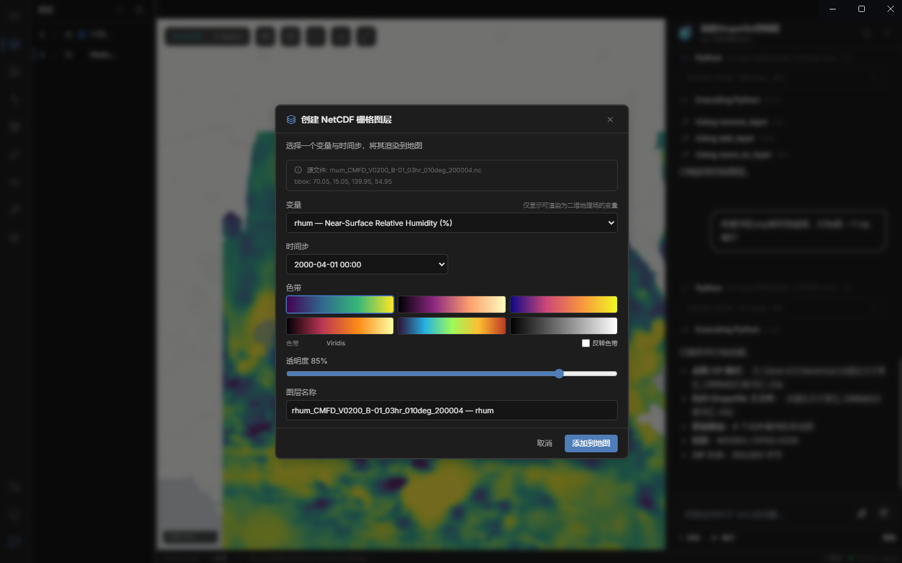

<p align="center">
  
</p>

<h1 align="center">AutoGIS</h1>

<p align="center">
  <strong>中文</strong> |
  <a href="README.md">English</a>
</p>

<p align="center">
  <strong>Agent 驱动的开源 GIS 桌面应用 —— 新增 NetCDF / 气象数据可视化 —— 用自然语言完成地理空间分析、制图、自动化与知识沉淀</strong>
</p>

<p align="center">
  <a href="#本分支更新">本分支更新</a> •
  <a href="#1-介绍">介绍</a> •
  <a href="#2-功能概览">功能概览</a> •
  <a href="#3-快速开始">快速开始</a> •
  <a href="#4-开发指南">开发指南</a> •
  <a href="#5-致谢与许可">致谢与许可</a>
</p>

<p align="center">
  
  
  
  
  
  
  
</p>

---

> [!IMPORTANT]
> **本项目是基于 [OpenGIS](https://github.com/ATFfang/OpenGIS) 的二次开发分支。** 完整保留了上游能力，并新增了下面列出的改进，重点面向气象 / 气候数据工作流。

## 本分支更新

本分支在 OpenGIS 基础上开发，新增内容如下。完整变更记录见 [`update-zh.txt`](update-zh.txt) / [`update.txt`](update.txt)。

### 🆕 NetCDF（`.nc`）导入与可视化 —— 面向气象研究的核心增强

本次二次开发的重点。原版 OpenGIS 不支持 NetCDF；本分支为 CF 风格的 NetCDF 文件（NCEP/NCAR 再分析、CMIP 等）打通了端到端流程：

- **三处导入**：加号选文件、拖拽到图层面板、工作区资源管理器双击，均支持 `.nc` / `.nc4`。
- **ArcGIS 风格配置窗口**：导入即弹出"创建 NetCDF 栅格图层"面板（视觉风格与 AutoGIS 一致），可选择变量、时间步、层级、色带、透明度与图层名。
- **真正的栅格渲染，而非静态图片**：选定的二维切片导出为 EPSG:4326 GeoTIFF，走 AutoGIS 现有的 XYZ 瓦片通路——可缩放、样式可编辑、支持任意坐标系。
- **自动识别坐标轴**：从常见 CF 别名自动识别 lat / lon / time / level，支持时间维与可选层级 / 气压维。
- **依赖**：`xarray`、`netCDF4`、`bottleneck`（已在 `pyproject.toml` 中声明）。

新增文件/模块：`integrations/gis/netcdf_service.py`、RPC 方法 `rpc.gis.inspect_netcdf` / `rpc.gis.render_netcdf`、`src/services/geo/netcdfService.ts`、`src/features/layers/NetCDFConfigModal.tsx`。

<p align="center">
  
</p>
<p align="center"><sub>NetCDF 配置窗口：选择变量与时间步、设定色带，即可将切片作为可交互图层添加到地图。</sub></p>

### 🐛 Bug 修复与健壮性

| 修复 | 问题 |
|---|---|
| **底图黑屏** | 拖动面板时 MapLibre 未重算尺寸；为地图容器加入 `ResizeObserver`。 |
| **Shapefile 填充分界** | 缓冲区算法产生的近零面积退化洞破坏 earcut 三角剖分，缩放时出现笔直的颜色分界；渲染前剔除退化环。 |
| **"请求缓慢"误报** | 沙箱启动失败（改名后 editable 安装路径失效）被误报成 API 请求慢。已修复根因、放宽沙箱就绪超时，并改正错误文案。 |
| **Agent `list index out of range`** | 部分 OpenAI 兼容服务在流末尾发空 `choices` 块；已加防护。 |
| **matplotlib 色带崩溃** | matplotlib ≥3.7 移除了 `cm.get_cmap`，导致栅格瓦片渲染报错；改用 colormaps 注册表。 |
| **开发者工具弹窗** | 开发模式不再每次启动弹 DevTools（可通过 `AUTOGIS_OPEN_DEVTOOLS=1` 开启）。 |

### 🔤 品牌改名：OpenGIS → AutoGIS

全项目改名——显示文案、包名、目录、RPC 协议常量、用户数据目录（`%APPDATA%/autogis`）。上游项目仍为 OpenGIS，本分支为 AutoGIS。

### 📦 Windows 安装包

提供可直接安装的 NSIS 安装包（`AutoGIS-0.2.0-win-x64.exe`），见 [Releases](../../releases)。首次启动时程序会自动准备 Python 环境（需联网）。

---

## 1. 介绍

AutoGIS 是一个基于 Agent 的开源 GIS 桌面应用。它不是一个简单的"地图 + 聊天框"，而是把 **GIS 数据管理、地图渲染、空间分析、制图导出、工作流、后台 Worker、可复用 Operation、记忆系统和工具治理** 放在同一个桌面环境里。本分支额外面向 **气象 / 气候数据工作流**，提供原生 NetCDF 可视化。

项目仍在迭代中。当前目标不是替代 ArcGIS Pro / QGIS 的全部能力，而是探索更自然的 GIS 工作方式：用户用自然语言描述意图，Agent 在受控工具系统中读取数据、运行代码、调用地图能力、生成图表、沉淀可复用 Operation，并把结果直接展示在地图、对话或制图画布中。

## 2. 功能概览

功能继承自 OpenGIS，并叠加本分支的新增内容。

### 2.1 Agent 能力

- **函数调用 Agent Loop**：以结构化工具调用为主路径。
- **代码执行**：受控的 Python 执行，用于临时 GIS 分析、清洗、绘图。
- **工具治理**：统一的 schema、权限、结果规范化与事件归档。
- **Plan / Sub-Agent / Workflow**：共享同一套 session / run / MessagePart 协议。
- **记忆与知识沉淀**：MemoryStore、ContextProjector、KnowledgeExtractor、FailureMemory。
- **Operation 复用**：把复杂分析沉淀为可编辑、可验证、可运行的原子能力。
- **Worker 后台任务**：常驻 Python Worker，支持动态数据与实时地图渲染。

### 2.2 GIS 与地图能力

- **矢量**：GeoJSON、CSV、Shapefile、KML、GeoPackage。
- **栅格**：GeoTIFF / TIFF，前后端混合瓦片渲染，色带控制。
- **NetCDF**（新增）：CF 风格 `.nc` 文件，支持变量 / 时间步 / 层级选择。
- **地图渲染**：MapLibre GL JS —— 点 / 线 / 面、分类与分级设色、变量映射、排序、标注、过滤、高亮。
- **制图画布**：Layout Composer，支持地图框、比例尺、指北针、图例、图片导出。
- **数据透视**：表格、统计、字段分布与 Agent 分析结果。

### 2.3 自动化与扩展

- **Workflow**：基于 DAG 的多步分析（`.flow.json`）。
- **Operation**：带输入输出 schema、代码、文档与运行历史的可复用原子能力。
- **Worker**：常驻 Python 服务，用于持续数据处理与动态渲染。
- **Project Skills**：项目级能力 / 知识包。
- **Run Archive**：每一轮 Agent 执行都以事件流归档。

完整架构（进程模型、双向 JSON-RPC、Agent 内部机制、目录结构、开发指南）参见[上游 OpenGIS 文档](https://github.com/ATFfang/OpenGIS)。

## 3. 快速开始

### 3.1 安装 Windows 安装包（最简单）

1. 从 [Releases](../../releases) 下载 `AutoGIS-0.2.0-win-x64.exe`。
2. 运行安装程序，选择安装目录，可选择创建桌面快捷方式。
3. 首次启动会自动准备 Python 环境 —— **首次运行请保持联网**（若无 Python 会下载独立版本、创建 venv 并安装依赖）。

### 3.2 从源码运行

前置依赖：Node.js ≥ 18、Python ≥ 3.11、Git、LLM API Key（仅地图功能无需 Agent）。

```bash
git clone <repo-url>
cd AutoGIS
npm install
npm run setup:python     # 创建 %APPDATA%/autogis/venv 并安装后端依赖
npm run dev:electron
```

然后打开 **设置 → 模型**，配置提供方 / Base URL / API Key / 模型名，发一句"你好"验证链路。

## 4. 开发指南

```bash
npm run dev:electron     # 桌面开发模式
npm run typecheck        # TypeScript 类型检查
npm test                 # 前端单元测试
npm run build            # 构建主进程 / preload / renderer
npm run dist:win         # 打包 Windows NSIS 安装包
```

后端测试：

```powershell
& "$env:APPDATA/autogis/venv/Scripts/python.exe" -m unittest discover -s python-backend/tests
```

**给贡献者的提醒**：重命名或移动仓库目录后，请用 venv 的 Python 在 `python-backend/` 下重新执行 `pip install -e .`，否则 editable 安装仍指向旧路径，代码执行沙箱将无法启动。

## 5. 致谢与许可

- **上游**：[OpenGIS](https://github.com/ATFfang/OpenGIS)（作者 ATFfang）——本项目为二次开发分支，保留全部上游功能。
- **许可**：MIT。原始版权归 OpenGIS 贡献者所有；分支修改部分归 AutoGIS 贡献者所有。

本项目采用 **MIT 许可证**，详见 [`LICENSE`](LICENSE)。

---

AutoGIS 仍在开发中。代码与文档如有出入，以代码和测试为准。
